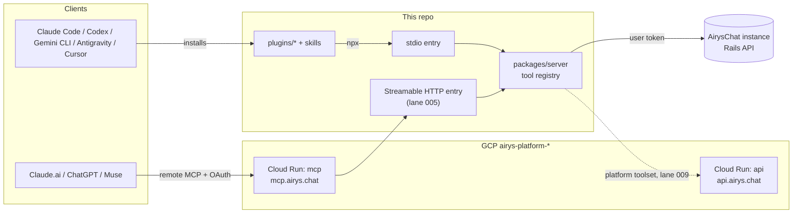

# Architecture

Status: 2026-10-26. Decisions behind this live in [docs/adr](adr).

## Server internals

| Module | Role |
|---|---|
| `src/index.ts` | stdio entry: load config, build client, register tools |
| `src/config.ts` | env validation (`AIRYSCHAT_*`), toolset parsing, read-only |
| `src/client.ts` | HTTP client; routes account-relative paths to `/api/v1`, `/api/v2` or `/saas/api/v1`; maps errors (plan gates vs auth) |
| `src/result.ts` | `json`, `untrustedJson` (prompt-injection fence), `failure`, `requireConfirmation` |
| `src/toolsets.ts` | `defineTool`, `registerTools` — write/irreversible metadata drives annotations and the read-only gate |
| `src/tools/<toolset>.ts` | Tool definitions per toolset |
| `src/tools/raw.ts` | `airyschat_api` escape hatch (catalog-validated from lane 002) |

### Layers of control

1. **Toolsets** — which families are on (`AIRYSCHAT_TOOLSETS`).
2. **Stability** — which maturity is visible (`AIRYSCHAT_FEATURES`, lane 001).
3. **Read-only** — no write tools registered (`AIRYSCHAT_READ_ONLY`).
4. **Confirmation** — irreversible tools refuse without `confirm: true` (elicitation in lane 007).
5. **Untrusted fence** — customer content is labelled data, never instructions.
6. **AirysChat authorization** — every call uses the user's token, so Pundit policies apply.

## Coverage model

`docs/api/inventory.csv` lists every account-scoped AirysChat endpoint (from `rails routes`) with its
target toolset/release and coverage (`curated`, `raw`, `excluded`, `removed`). Lane 002 turns it into
an embedded catalog searchable by `airyschat_api_search`, so agents can reach any endpoint safely
before a curated tool exists (ADR 0002).

## Related repositories

| Repo | Relationship |
|---|---|
| `AirysChat/AirysChat` | The API we wrap (source of truth: routes, controllers, swagger) |
| `AirysBR/airys-platform` | Cloud Run/Terraform home of the hosted `mcp` service; platform API for lane 009 |
| `AirysBR/Airys-AI` | Platform specs |
