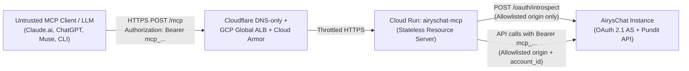

# Security Review — Lane 005: Hosted MCP on Cloud Run (`REM-12`)

- **Date**: 2026-10-28
- **Scope**: `packages/server/src/auth.ts`, `packages/server/src/http.ts`, `packages/server/src/server.ts`, `packages/server/src/toolsets.ts`, `packages/server/src/tools/raw.ts`, `Dockerfile`, `.github/workflows/image.yml`
- **ADRs**: [ADR 0004](../adr/0004-hosted-mcp-cloud-run.md), [ADR 0006](../adr/0006-hosted-auth-scoped-mcp-tokens.md)
- **Reviewer**: `safety-reviewer` checklist + automated test suite (`packages/server/test/auth.test.ts`, `packages/server/test/http.test.ts`, `packages/server/scripts/smoke.mjs`)

---

## 1. Threat Model & Trust Boundaries

- **Untrusted inputs**:
  1. HTTP request URL path, `Host` / `X-Forwarded-Host`, `X-AirysChat-Instance`, `X-AirysChat-Account`, `Authorization` headers, and JSON-RPC request bodies from the client.
  2. Tool call arguments generated by the LLM (potentially influenced by prompt injection in customer conversations).
  3. Upstream JSON payloads returned by AirysChat containing customer-authored messages, contact names, template bodies, CRM notes, and CSAT feedback.

---

## 2. Control-by-Control Review

### 2.1 Server-Side Request Forgery (SSRF)

| Risk | Mitigation in Code | Verification |
|---|---|---|
| Attacker passes an arbitrary upstream URL via `X-AirysChat-Instance`, `Host`, or `/<instance>/mcp` to probe internal GCP metadata (`169.254.169.254`) or private services. | `validateInstanceOrigin` and `loadInstanceAllowlist` (`src/auth.ts`) pre-validate every allowed instance at startup (`https://` required outside localhost, no credentials, no paths/queries/fragments, explicit denylist for `169.254.169.254` and `metadata.google.internal`). `resolveRequestRoute` resolves `instance.baseUrl` strictly by dictionary lookup (`allowlist.byKey` / `allowlist.byMcpHost`) **before** token introspection or tool dispatch. Unallowlisted instances return `400 unknown_instance` with zero outbound network requests. | `test/auth.test.ts`, `test/http.test.ts` (`outboundUrls.length === 0`), and `scripts/smoke.mjs`. |
| Path traversal through `path` argument in `airyschat_api` or tool parameters. | `AirysChatClient.buildUrl` constructs URLs via `new URL(...)`, and `airyschat_api` (`src/tools/raw.ts`) matches every call against `catalog.json` via `matchEndpoint` before making any request. | `test/catalog.test.ts` and `scripts/smoke.mjs`. |

### 2.2 Token Handling, Caching & Audience Binding

| Risk | Mitigation in Code | Verification |
|---|---|---|
| Full-permission classic `api_access_token` used against hosted MCP. | Rejected at the edge in `AirysChatTokenIntrospector.verifyRequest` (`src/auth.ts`): `api_access_token` request headers and Bearer tokens without the `mcp_` prefix are refused with `401 invalid_token` before hitting upstream, and introspection responses with `token_use: "classic"` or `is_mcp_token: false` are also rejected. | `test/auth.test.ts` and `scripts/smoke.mjs`. |
| Token issued for another resource replayed against hosted MCP (confused deputy / MCP SDK < 2.3.0 advisory). | `AirysChatTokenIntrospector` requires `aud` in the introspection response to match the canonical MCP `resourceUrl` (or its origin) and passes `expectedResource` to `@modelcontextprotocol/server`'s `verifyBearerToken`. | `test/auth.test.ts` (`mcp_wrong_aud` → `401`) and `scripts/smoke.mjs`. |
| Cross-account privilege escalation using a valid MCP token. | `accountId` comes exclusively from the introspection response (`payload.account_id`), never from client parameters. If the client sends `X-AirysChat-Account`, `enforceAccountHeaderMatch` rejects any mismatch with `401 invalid_token`. | `test/auth.test.ts` (`reqMismatch` → `401`). |
| Revoked token remains usable for too long or raw tokens leak via cache/logs. | Introspection cache TTL is hard-capped at `60` seconds (`Math.min(..., 60)`) and bounded by the token's `exp`. Cache keys are `SHA-256(instanceBaseUrl + "\0" + resourceUrl + "\0" + token)`. Logs record only `token_fp` (first 12 hex chars of SHA-256) via `formatStructuredLog`, which serializes an allowlisted set of 10 operational keys and never touches headers, arguments, or payloads. | `test/auth.test.ts`, `test/http.test.ts`, and `scripts/smoke.mjs`. |

### 2.3 Scope Bypass Prevention

| Risk | Mitigation in Code | Verification |
|---|---|---|
| A `mcp:read` or `mcp:write` token bypasses `tools/list` filtering by calling a tool directly or by calling `airyschat_api` (the raw escape hatch). | 1. `registerTools` (`src/toolsets.ts`) filters out disallowed tools from `tools/list` AND enforces a pre-call refusal gate (`scopeRefusal`) inside the handler wrapper. 2. `airyschat_api` (`src/tools/raw.ts`) checks `config.maxAccess` against `method !== 'GET'` (`mcp:write` required) and `entry.irreversible` (`mcp:irreversible` required). 3. When `config.toolsetsRestricted` is true (`mcp:toolset:<name>`), `airyschat_api` also verifies `config.toolsets.has(entry.toolset)` so a CRM-only token cannot call WhatsApp or Admin endpoints via `airyschat_api`. | `test/toolsets.test.ts`, `test/http.test.ts`, and `scripts/smoke.mjs`. |

### 2.4 Denial of Service (DoS) & Container Hardening

| Risk | Mitigation in Code | Verification |
|---|---|---|
| Memory exhaustion via oversized JSON-RPC payloads or unbounded caches. | `startHttpServer` and `WebStandardStreamableHTTPServerTransport` enforce `DEFAULT_HTTP_MAX_BODY_BYTES = 256 KiB` (`413 Payload Too Large` before buffering). `AirysChatTokenIntrospector` caps `maxCacheEntries = 1000` with FIFO eviction; `SlidingWindowRateLimiter` caps `maxKeys = 5000` and limits each token to `120 req/min` (`429 Too Many Requests` with `Retry-After`). | `test/http.test.ts` (`413` and `429` tests) and `test/auth.test.ts`. |
| Container compromise / RCE escalation. | `Dockerfile` uses `gcr.io/distroless/nodejs24-debian12:nonroot` (runs as UID `65532`, no shell, no package manager, read-only application artifacts). | `.github/workflows/image.yml`. |

### 2.5 Prompt-Injection Surface

| Risk | Mitigation in Code | Verification |
|---|---|---|
| Malicious instructions in a customer WhatsApp message or CRM note trick the model into sending messages, closing deals, or launching campaigns. | 1. All tools returning customer-authored content wrap outputs in `untrustedJson` (both text fence and `structuredContent._untrusted`). 2. All customer-visible or Meta-billed actions declare `irreversible: true` and require `confirm: true` (`requireConfirmation`). 3. On hosted MCP, connectors default to `mcp:read` (or `mcp:write`), which makes `irreversible: true` tools completely unreachable even if the model sets `confirm: true`. | `test/result.test.ts`, `test/http.test.ts`, and `scripts/smoke.mjs`. |

---

## 3. Verdict

**PASS** — All in-repo controls for Lane `005-hosted-mcp` (`REM-01`..`REM-06`, `REM-09`, `REM-12`, `REM-15`) are implemented, unit-tested, and smoke-tested. Production traffic remains gated on external tasks `REM-07` (`airys-platform/infra` Terraform apply) and `REM-10` (`AirysChat/AirysChat` lane `025-mcp-tokens-and-oauth`).
