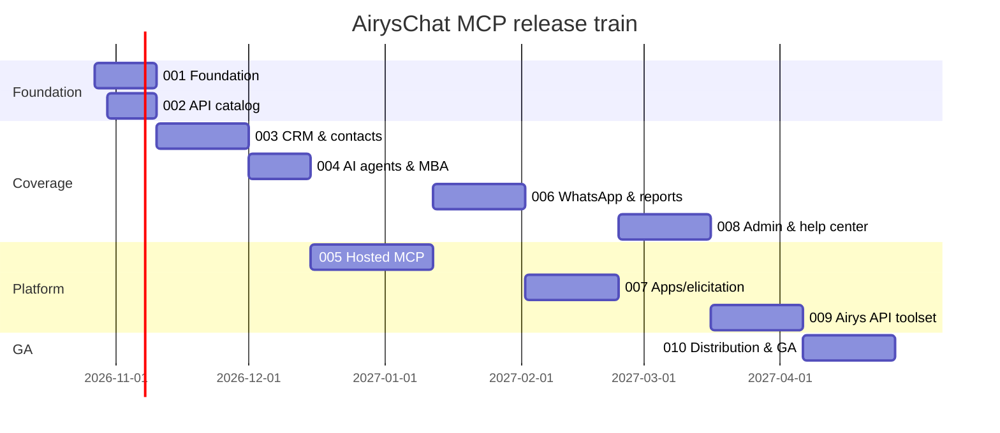

# Roadmap and release train

Status as of **2026-10-26**: v0.1.0 exists (28 tools, unreleased, verified only against a mock).
The project restarts with lane 001. Coverage numbers come from [docs/api/coverage.md](../docs/api/coverage.md).

**North star:** every AirysChat action is reachable by any agent — Claude, ChatGPT, Muse, Codex,
Gemini, Antigravity — safely, from a local install or a hosted URL.

## Release train

Dates are targets; the lane scope is the contract (ADR 0003).

| Release | Theme | Lanes | Target | Endpoints planned | Gate to ship |
|---|---|---|---|---:|---|
| **0.2.0** | Foundation & catalog | [001](001-foundation/spec.md), [002](002-api-catalog/spec.md) | 2026-11-09 | discovery of all 775 | CI green, v0.1 tools live-verified on staging, `airyschat_api_search` works |
| **0.3.0** | CRM & contacts | [003](003-crm-and-contacts/spec.md) | 2026-11-30 | 216 | CRM read+write tools `beta`, deal won/lost gated, verified on staging acct 6 |
| **0.4.0** | AI agents & Meta Business Agent | [004](004-ai-agents-and-meta-agent/spec.md) | 2026-12-14 | 216 | Read tools `stable`, writes `beta`, responder-ownership guard verified |
| **0.5.0** | Hosted MCP (Cloud Run) | [005](005-hosted-mcp/spec.md) | 2027-01-11 | — | `mcp.airys.chat` serving phase-1 auth, security review passed |
| **0.6.0** | WhatsApp complete & reports | [006](006-whatsapp-and-reports/spec.md) | 2027-02-01 | 100 | Templates CRUD + reports v2 curated |
| **0.7.0** | MCP Apps, elicitation, tasks | [007](007-apps-elicitation-tasks/spec.md) | 2027-02-22 | — | CRM board + preflight report render in Claude and ChatGPT |
| **0.8.0** | Admin & help center | [008](008-admin-and-help-center/spec.md) | 2027-03-15 | 213 | Admin toolset `beta`, destructive ops gated |
| **0.9.0** | Airys API (platform) toolset | [009](009-airys-platform-toolset/spec.md) | after airys-platform M2 | — | Number health and alerts from `api.airys.chat` |
| **1.0.0** | GA & distribution | [010](010-distribution-ga/spec.md) | 2027-04-30 | — | Public repo/npm, MCP Registry, 4 client plugins, OAuth (005b) live |

## Lanes

| Lane | Prefix | Status |
|---|---|---|
| [001-foundation](001-foundation/tasks.md) | FND | In progress |
| [002-api-catalog](002-api-catalog/tasks.md) | CAT | In progress (inventory done) |
| [003-crm-and-contacts](003-crm-and-contacts/tasks.md) | CRM | Planned |
| [004-ai-agents-and-meta-agent](004-ai-agents-and-meta-agent/tasks.md) | AIA | Planned |
| [005-hosted-mcp](005-hosted-mcp/tasks.md) | REM | Planned |
| [006-whatsapp-and-reports](006-whatsapp-and-reports/tasks.md) | WAR | Planned |
| [007-apps-elicitation-tasks](007-apps-elicitation-tasks/tasks.md) | APP | Planned |
| [008-admin-and-help-center](008-admin-and-help-center/tasks.md) | ADM | Planned |
| [009-airys-platform-toolset](009-airys-platform-toolset/tasks.md) | PLT | Planned |
| [010-distribution-ga](010-distribution-ga/tasks.md) | GA | Planned |

## Decisions pending from the owner

| Topic | Lane | Recommendation |
|---|---|---|
| OAuth design for hosted MCP (Doorkeeper in AirysChat vs `mcp` as AS + consent page vs MCP-scoped tokens) | 005 | `mcp` as AS with CIMD + AirysChat consent page now; scoped tokens later |
| Public npm before 1.0? | 001/010 | No — GitHub Packages until 1.0 |
| Captain (Chatwoot assistant) vs AirysChat AI Agents: which gets curated tools | 004 | AI Agents + MBA curated; Captain catalog-only unless still sold |
| Registry namespace `chat.airys/mcp` (DNS) vs `io.github.airyschat/mcp` | 010 | `chat.airys/mcp` |
