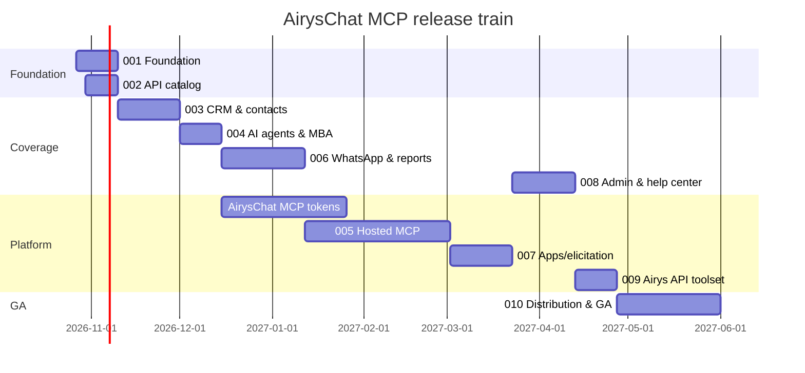

# Roadmap and release train

Status as of **2026-10-26**: v0.1.0 exists (28 tools, unreleased, verified only against a mock).
The project restarts with lane 001. Coverage numbers come from [docs/api/coverage.md](../docs/api/coverage.md).

**North star:** every AirysChat action is reachable by any agent — Claude, ChatGPT, Muse, Codex,
Gemini, Antigravity — safely, from a local install or a hosted URL.

## Release train

Dates are targets; the lane scope is the contract (ADR 0003).

| Release | Theme | Lanes | Target | Endpoints planned | Gate to ship |
|---|---|---|---|---:|---|
| **0.2.0** | Foundation & catalog | [001](001-foundation/spec.md), [002](002-api-catalog/spec.md) | 2026-11-09 | discovery of all 775 | CI green, v0.1 tools live-verified on staging, `airyschat_api_search` works |
| **0.3.0** | CRM & contacts | [003](003-crm-and-contacts/spec.md) | 2026-11-30 | 216 | CRM read+write tools `beta`, deal won/lost gated, verified on staging acct 6 |
| **0.4.0** | AI agents & Meta Business Agent | [004](004-ai-agents-and-meta-agent/spec.md) | 2026-12-14 | 216 | Read tools `stable`, writes `beta`, responder-ownership guard verified |
| **0.5.0** | WhatsApp complete & reports | [006](006-whatsapp-and-reports/spec.md) | 2027-01-11 | 100 | Templates CRUD + reports v2 curated |
| **0.6.0** | Hosted MCP (Cloud Run) + scoped MCP tokens | [005](005-hosted-mcp/spec.md) | 2027-03-01 | — | `mcp.airys.chat` with OAuth + scoped tokens (ADR 0006), AirysChat lane landed, security review passed |
| **0.7.0** | MCP Apps, elicitation, tasks | [007](007-apps-elicitation-tasks/spec.md) | 2027-03-22 | — | CRM board + preflight report render in Claude and ChatGPT |
| **0.8.0** | Admin & help center | [008](008-admin-and-help-center/spec.md) | 2027-04-12 | 213 | Admin toolset `beta`, destructive ops gated |
| **0.9.0** | Airys API (platform) toolset | [009](009-airys-platform-toolset/spec.md) | after airys-platform M2 | — | Number health and alerts from `api.airys.chat` |
| **1.0.0** | GA & distribution | [010](010-distribution-ga/spec.md) | 2027-05-31 | — | Public repo/npm, MCP Registry, 4 client plugins, connector directories |

> Renumbered on 2026-10-27: hosted MCP (lane 005) moved from 0.5 to 0.6 because the owner chose
> scoped MCP tokens issued by AirysChat (ADR 0006), which needs an AirysChat lane first. WhatsApp &
> reports (lane 006) moved up to 0.5. Later targets shifted by ~4 weeks.

## Lanes

| Lane | Prefix | Status |
|---|---|---|
| [001-foundation](001-foundation/tasks.md) | FND | Done (2026-10-27) |
| [002-api-catalog](002-api-catalog/tasks.md) | CAT | Done (2026-10-27) |
| [003-crm-and-contacts](003-crm-and-contacts/tasks.md) | CRM | Done (2026-10-27) |
| [004-ai-agents-and-meta-agent](004-ai-agents-and-meta-agent/tasks.md) | AIA | Done (2026-10-27) |
| [005-hosted-mcp](005-hosted-mcp/tasks.md) | REM | Done (2026-10-30; `mcp.airys.chat` live on Cloud Run with OAuth 2.1 + scoped MCP tokens) |
| [006-whatsapp-and-reports](006-whatsapp-and-reports/tasks.md) | WAR | Done (2026-10-27) |
| [007-apps-elicitation-tasks](007-apps-elicitation-tasks/tasks.md) | APP | Done (2026-10-28) |
| [008-admin-and-help-center](008-admin-and-help-center/tasks.md) | ADM | Done (2026-10-28) |
| [009-airys-platform-toolset](009-airys-platform-toolset/tasks.md) | PLT | Done (2026-10-30; all 7 endpoints live on staging & `api.airys.chat` prod via `AirysBR/airys-platform#29`) |
| [010-distribution-ga](010-distribution-ga/tasks.md) | GA | Done (2026-10-30; `@airyschat/mcp@1.0.0` live on `npmjs.org` with SLSA provenance + `https://mcp.airys.chat` on `1.0.0`) |

## Owner decisions

| Date | Topic | Decision | Record |
|---|---|---|---|
| 2026-10-27 | Hosted MCP auth | AirysChat issues scoped, revocable, audience-bound MCP tokens and acts as OAuth AS; hosted accepts only those (option c) | [ADR 0006](../docs/adr/0006-hosted-auth-scoped-mcp-tokens.md) |
| 2026-10-27 | Captain vs AI Agents | AI Agents + Meta Business Agent get curated tools; Captain stays catalog-only (`airyschat_api`) | lane 004, AIA-09 |
| 2026-10-27 | npm scope | `@airyschat` (npm org `airyschat`) belongs to Airys; GitHub Packages until 1.0, public npm at 1.0 | lane 010, GA-05 |
| 2026-10-27 | MCP Registry namespace | `chat.airys/mcp`, DNS TXT verification on `airys.chat` | lane 010, GA-06 |

## Decisions pending

None as of 2026-10-27.
